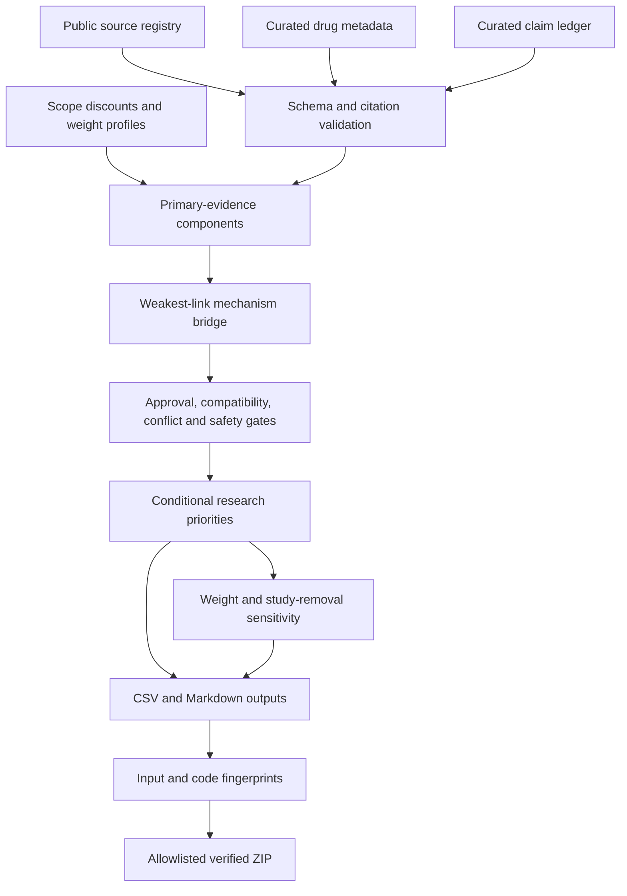

# Architecture

## Components

| Component | Implementation | Contract |
|---|---|---|
| Input loading | `load_inputs`, `validate_bundle`, `validate_settings` | Fail visibly on malformed records or broken references |
| Evidence scoring | `evaluate` | Primary claims only; no citation-count accumulation |
| Gating | `evaluate` | Holds and unresolved approval cannot be overridden numerically |
| Sensitivity | `sensitivity` | Profile x whole-study removal; mirrors removed together |
| Reporting | `render_report`, `write_csv`, `run` | Human-readable claims, sources, gaps and deterministic outputs |
| Packaging | `mva_track2.package` | Exact allowlist, no recursive raw-data inclusion, verified hashes |

## Identity and aggregation

`drug_id` identifies the proposed medication hypothesis. `source_id` identifies a
retrieved record; `study_id` identifies the underlying study or regulatory label.
Different mirrors of the same study must share `study_id`.

A claim can support a gene-mechanism link without testing its associated drug.
`dimension`, `scope`, and its written summary preserve that distinction.
Evidence reuse across hypotheses is explicit, not independent corroboration.

Within-step maxima avoid inflating support by adding more claims or mirrors.
All declared `mechanism_claim_groups` must retain primary support; the weakest
group determines the mechanism component. Alternative claims within a group
can substitute, but evidence for another step cannot.
The minimum of mechanism and drug-translation support prevents a strong generic
gene paper from compensating for a missing drug link.

## Boundaries

Literature inclusion, mechanistic relevance, contradiction judgments and safety
dispositions are manually curated inputs. The code does not assess the truth of
a paper, infer drug direction from free text, diagnose a patient or prescribe.

There are no external-service calls, model training or genomic-file parsers.
Adding a discovery connector is a separate extension and must retain
source-level provenance and the same evidence-review gates.
